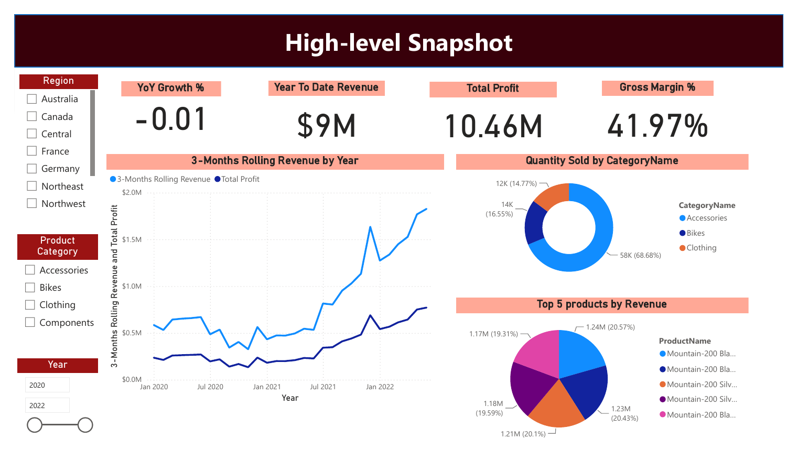
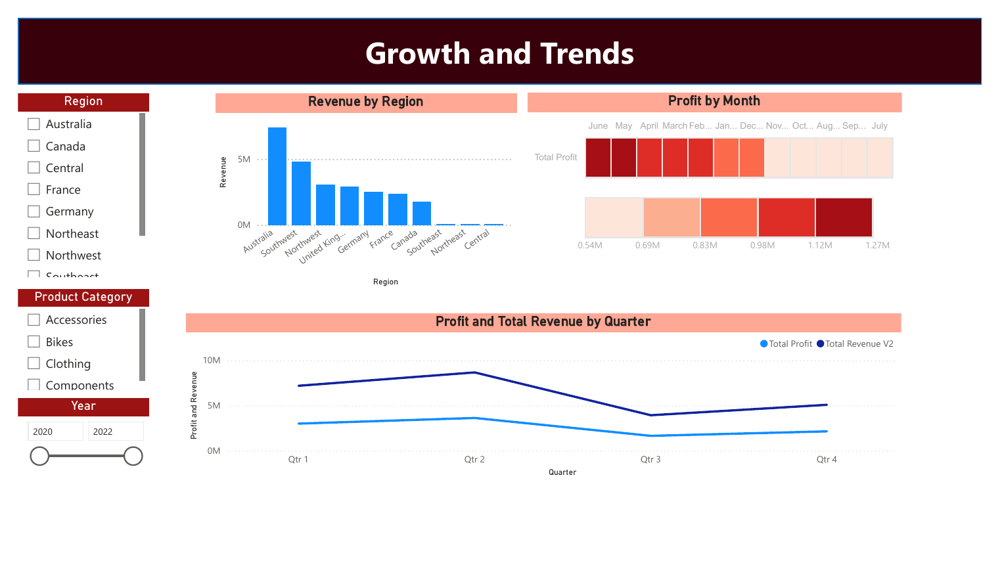
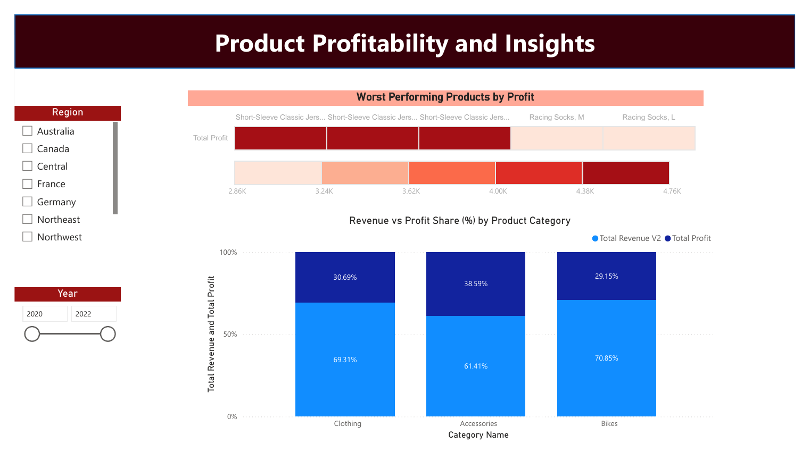
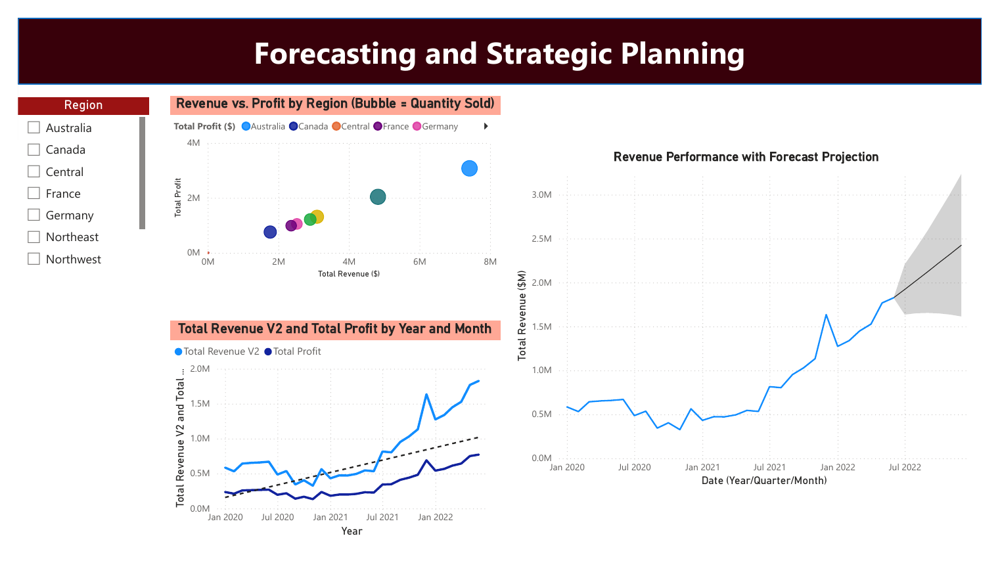

# Sales Performance Dashboard

School project. A four-page Power BI report on product sales, profit and revenue trends.

## Data

Adventure Works sample sales data: sales facts joined to product, product category, territory and calendar tables.

## Pages

| Page | What it shows |
|------|---------------|
| Overview | Year-to-date revenue, year-over-year growth, total profit, gross margin %, 3-month rolling revenue by year, revenue split by category, top 5 products by revenue. Filters: year, product category, region. |
| Trend | Profit by month (heat map), profit and revenue by quarter, revenue by region |
| Insight | Worst performing products by profit, revenue share vs profit share by product category |
| Strategic planning | Revenue vs profit by region (bubble size = quantity sold), revenue performance with forecast projection |

## DAX measures

Year-to-date revenue, YoY growth %, total profit, gross margin %, 3-month rolling revenue and quantity sold, held in a dedicated measures table.

## Preview

| Preview | Page |
|---------|------|
|  | High-level snapshot |
|  | Growth and trends |
|  | Product profitability and insights |
|  | Forecasting and strategic planning |

## Key figures (2020 to 2022)

- Year-to-date revenue of about $9M, total profit of 10.46M and a gross margin of 41.97%.
- Accessories account for 68.68% of quantity sold, bikes 16.55% and clothing 14.77%.
- Rolling 3-month revenue and profit both rise through 2021 and 2022, and the forecast projection continues the upward trend with a widening confidence band.

## Files

- `sales-performance-dashboard.pbix`
