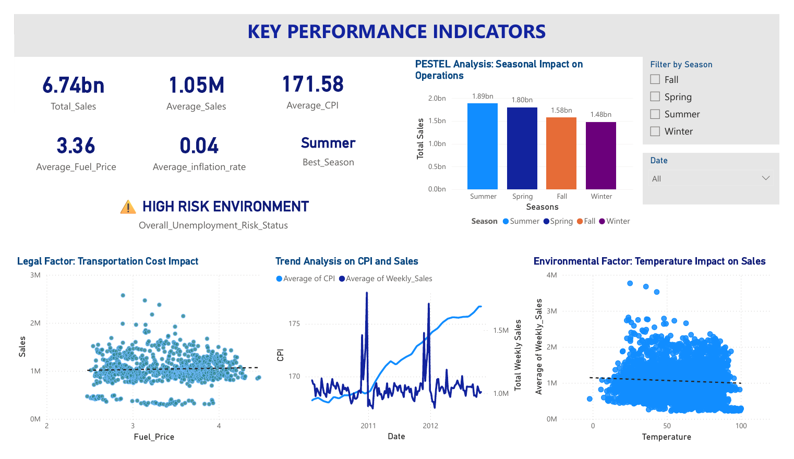
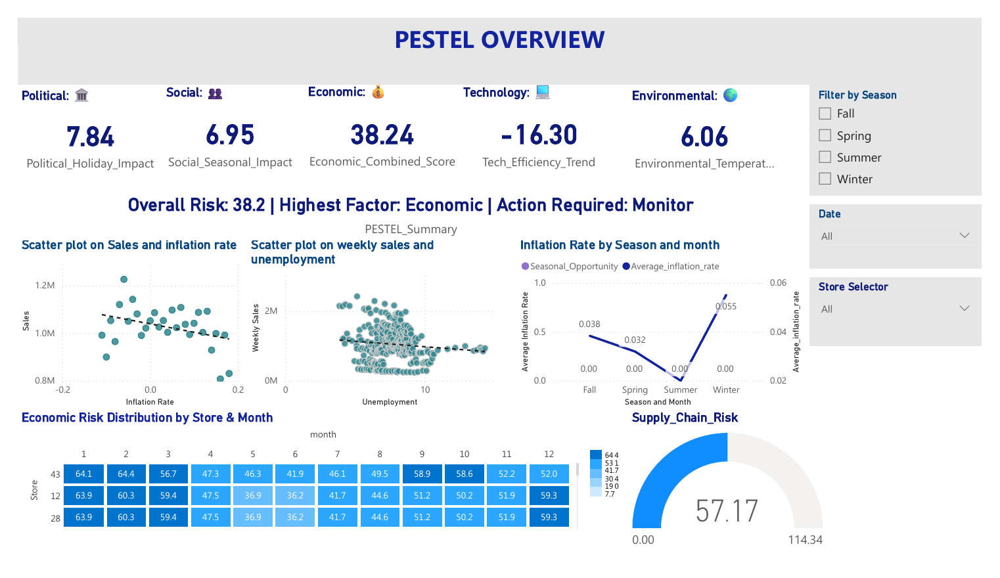
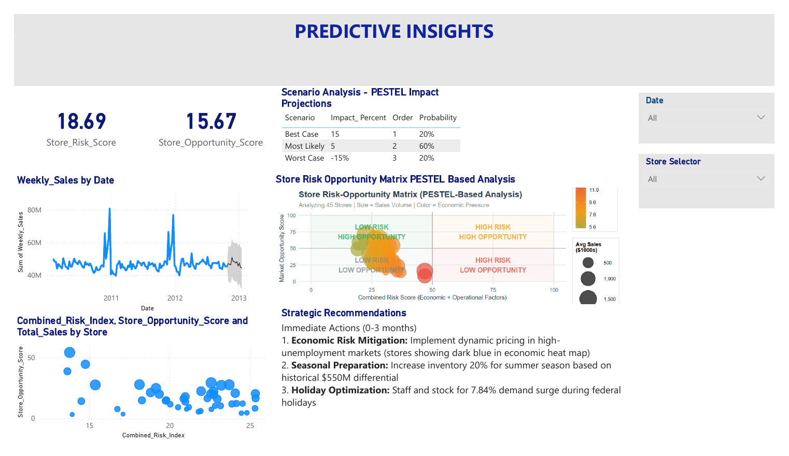

# Walmart PESTEL Analysis

School project. A three-page Power BI report that applies the PESTEL framework (Political, Economic, Social, Technological, Environmental, Legal) to weekly Walmart store sales.

## Data

Weekly sales by store with CPI, fuel price, unemployment, temperature, inflation rate, season and holiday information.

## Pages

| Page | What it shows |
|------|---------------|
| KPIs | Key indicators, trend of CPI against sales, seasonal impact on operations, transportation cost impact (legal factor), temperature impact on sales (environmental factor) |
| PESTEL Overview | One card per PESTEL factor, sales against inflation and against unemployment, economic risk heat map by store and month, inflation rate by season |
| Predictive Strategic Insights | Store risk and opportunity matrix (Python visual), weekly sales over time, scenario analysis with impact and probability, strategic recommendations |

## Measures

Average sales, CPI, fuel price and inflation rate, plus risk and opportunity scores per store, a combined economic score and an overall risk status.

## Preview

| Preview | Page |
|---------|------|
|  | Key performance indicators |
|  | PESTEL overview |
|  | Predictive strategic insights |

## Key figures

- Total sales of 6.74bn, average weekly sales of 1.05M and average CPI of 171.58.
- Summer is the best season for sales (1.89bn), followed by spring (1.80bn), fall (1.58bn) and winter (1.48bn).
- The overview rates overall risk at 38.2, with economic factors the highest and a recommended action of "Monitor". The unemployment status shows "High risk environment".
- The scenario table lists three cases: best case (+15% impact, 20% probability), most likely (+5%, 60%) and worst case (-15%, 20%).
- The strategic recommendations on the final page propose dynamic pricing in high-unemployment markets, a 20% summer inventory increase and extra staffing and stock for federal holidays.

## Files

- `walmart-pestel-analysis.pbix`

The risk matrix uses a Python visual, so Python must be configured in Power BI Desktop for that visual to render.
