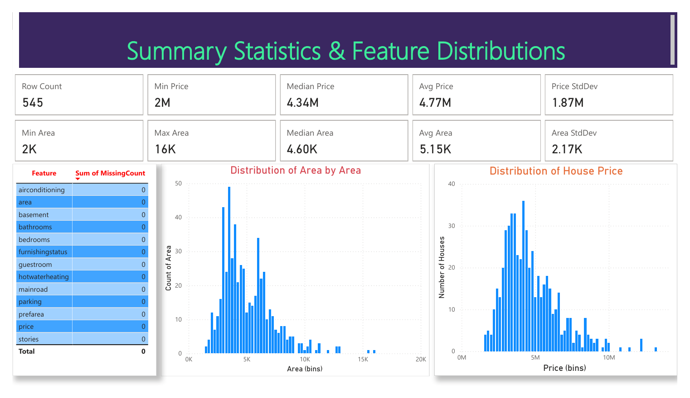
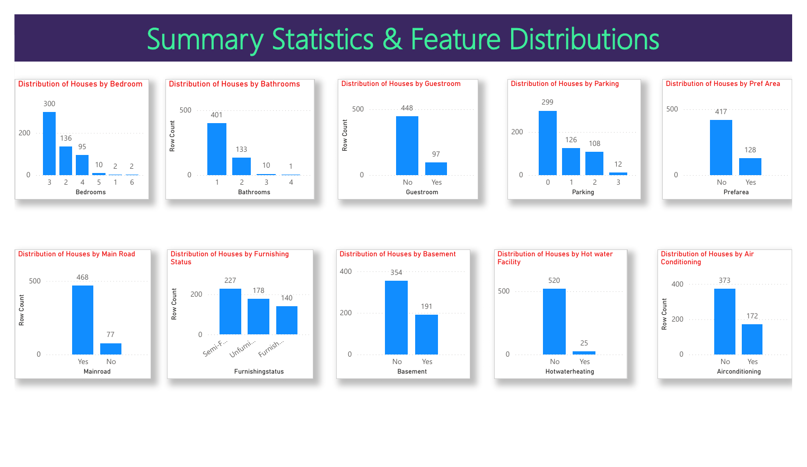
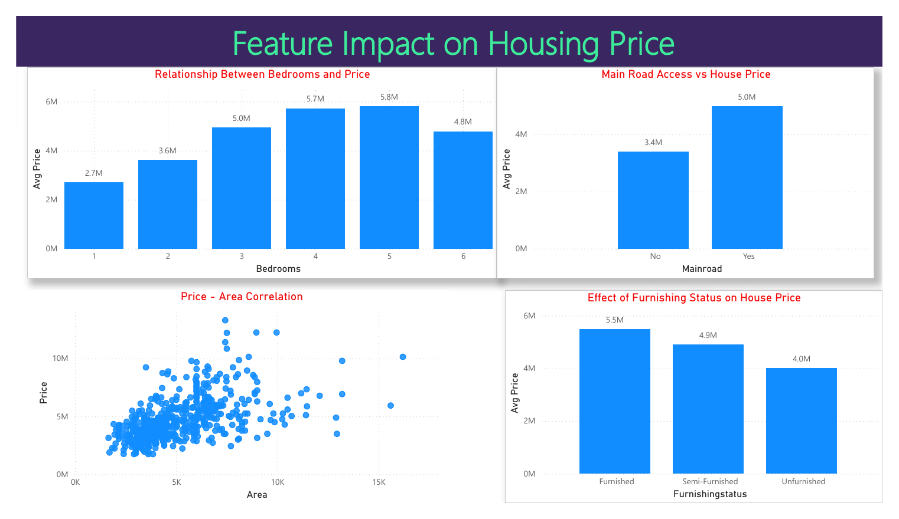
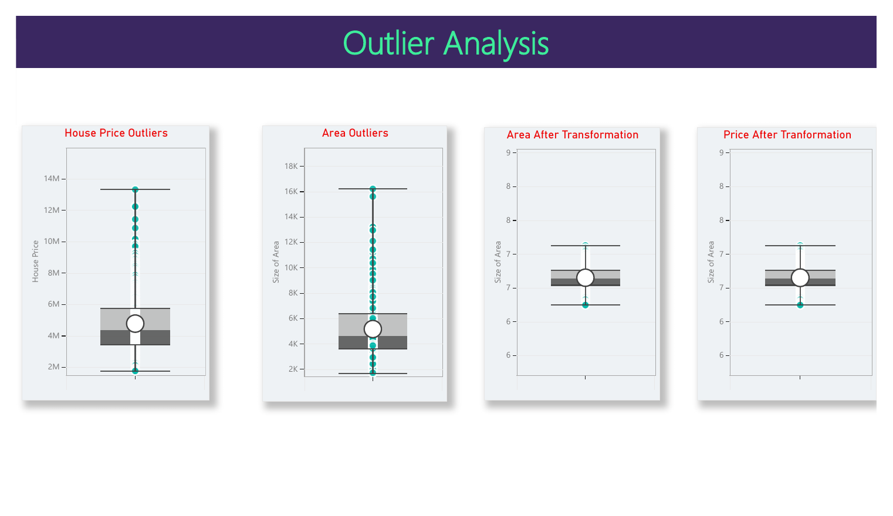
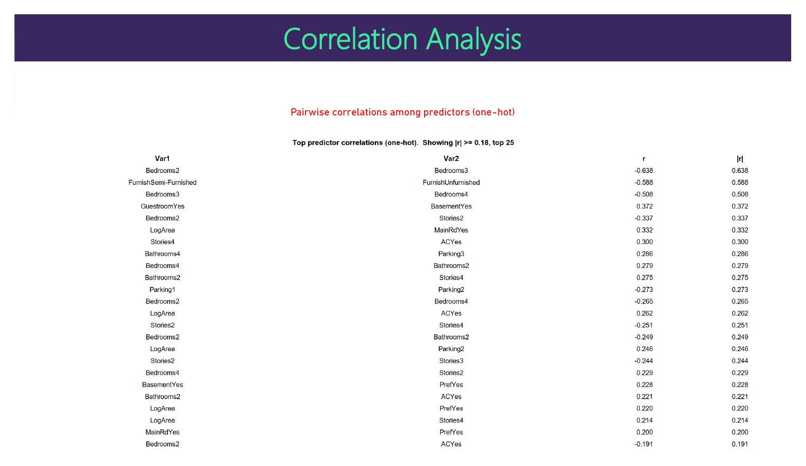
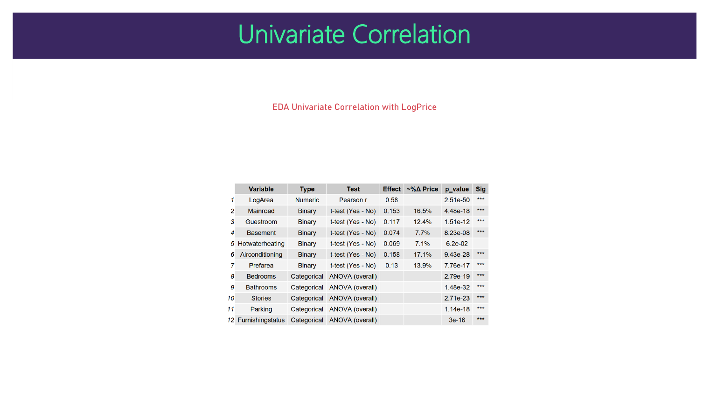
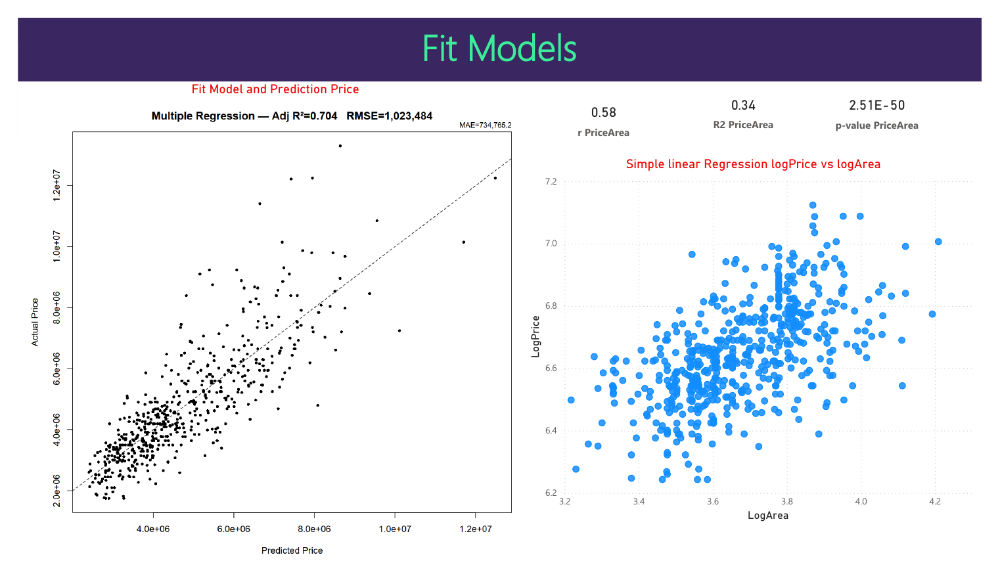
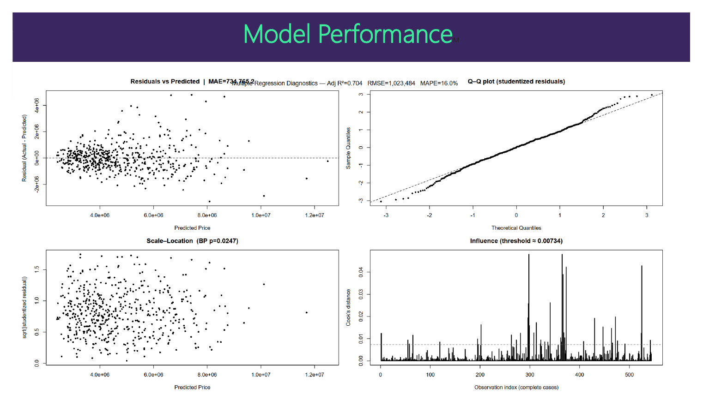

# Housing Price Regression

School project. An eight-page Power BI report that explores a housing dataset and fits a regression model for price, using R visuals.

## Data

545 house records with price, area, bedrooms, bathrooms, stories, parking and yes/no features (main road, guest room, basement, hot water heating, air conditioning, preferred area) and furnishing status. No missing values.

## Method

1. **Distributions.** Price and area are right-skewed (mean price 4.77M vs median 4.34M; mean area 5.15K vs median 4.60K).
2. **Outliers.** Box plots of price and area before and after a log transformation.
3. **Correlation.** Pearson correlation between area and price is 0.58. ANOVA showed price differs significantly across every categorical feature. Pairwise predictor correlations were checked for multicollinearity.
4. **Models.** Simple linear regression of log price on log area, then multiple regression on all predictors.

## Results

| Model | Result |
|-------|--------|
| Simple regression (log price vs log area) | R = 0.58, R² = 0.34 |
| Multiple regression | Adjusted R² = 0.704, MAPE about 16% |

- Properties near a main road average 5.0M vs 3.4M for those without.
- Average price rises from 4.0M (unfurnished) to 5.5M (furnished).
- Typical predictions are within about 735K, but homes above 10M are systematically under-predicted.

## Limitations

- Area and bedrooms overlap (VIF above 5 for some predictors), so the effect of bedrooms alone is hard to interpret.
- Some categories have few observations.
- The data has no neighbourhood quality, property age, amenities or market timing.

## Preview

| Preview | Page |
|---------|------|
|  | Summary statistics |
|  | Feature distributions |
|  | House price analysis |
|  | Outlier analysis |
|  | Correlation analysis |
|  | Univariate correlation |
|  | Fit models |
|  | Model performance (residuals, Q-Q plot, scale-location, influence) |

## Files

- `housing-price-regression.pbix`

The model and correlation pages use R visuals, so R must be configured in Power BI Desktop for them to render.
