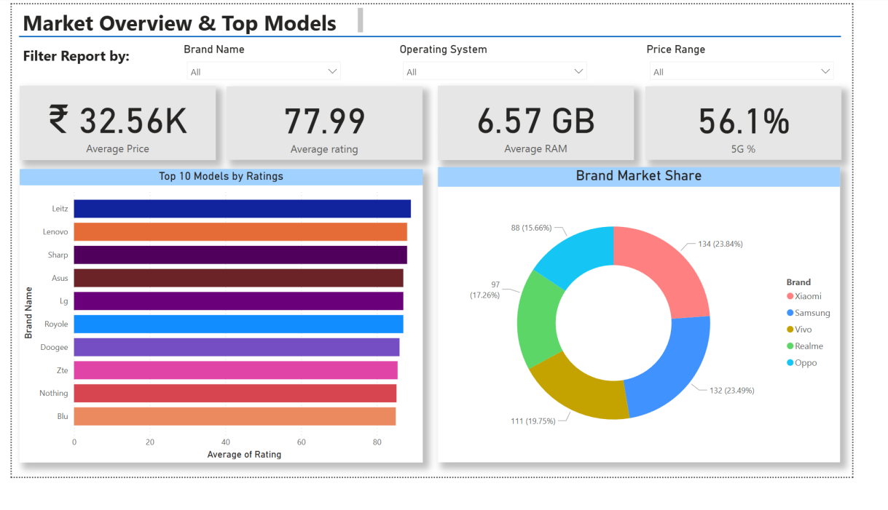
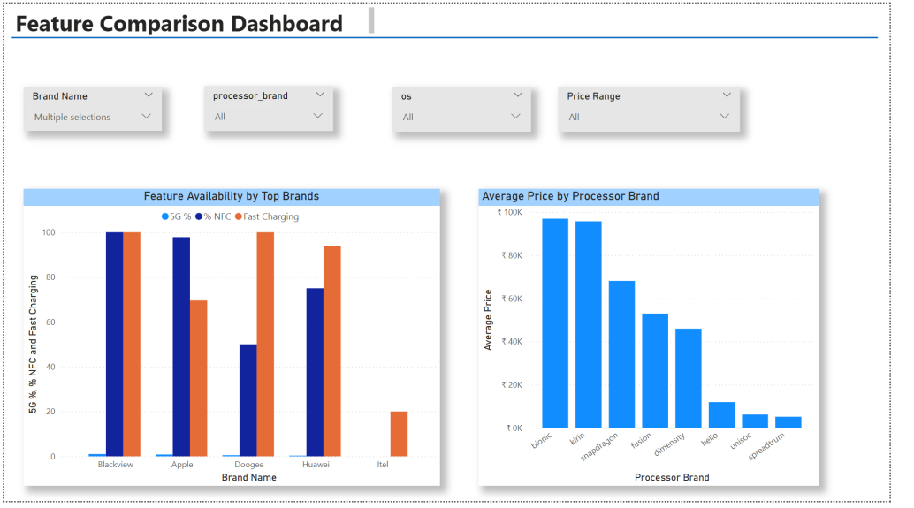
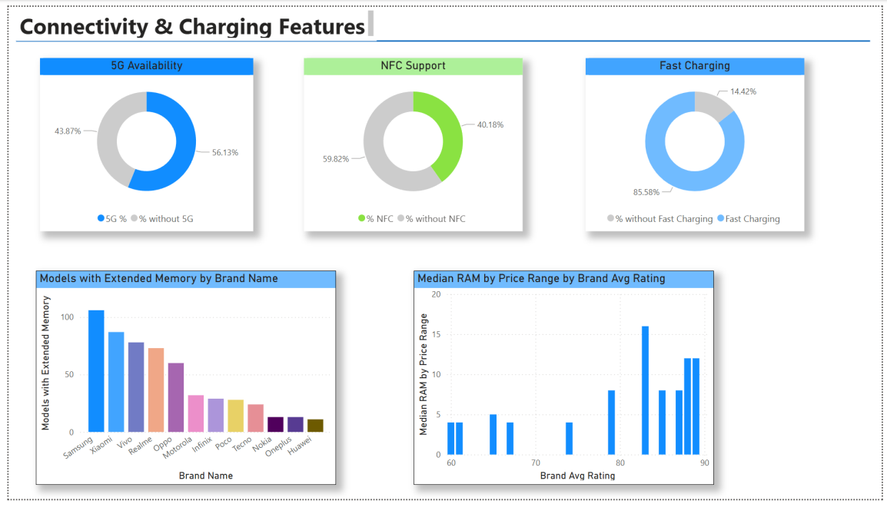
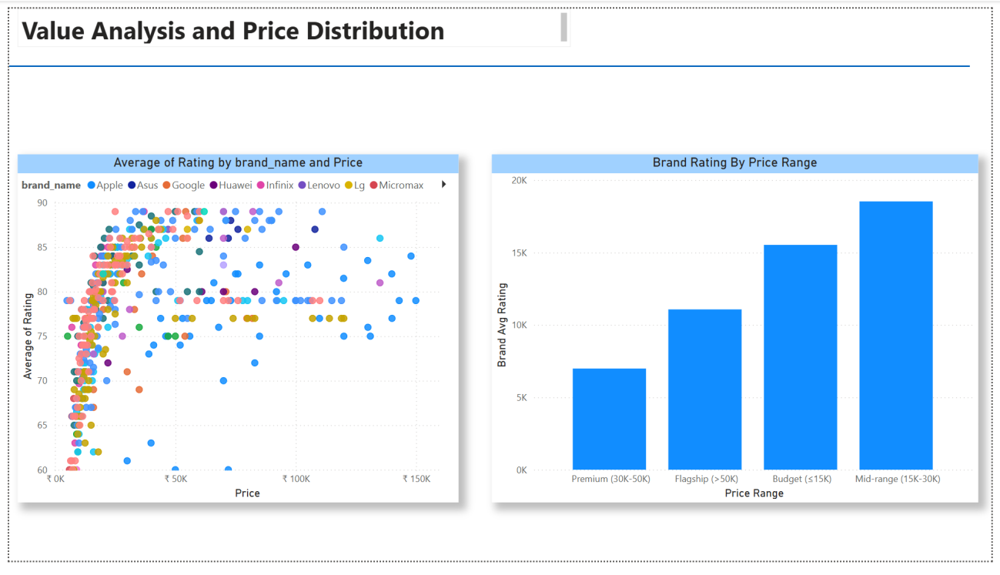
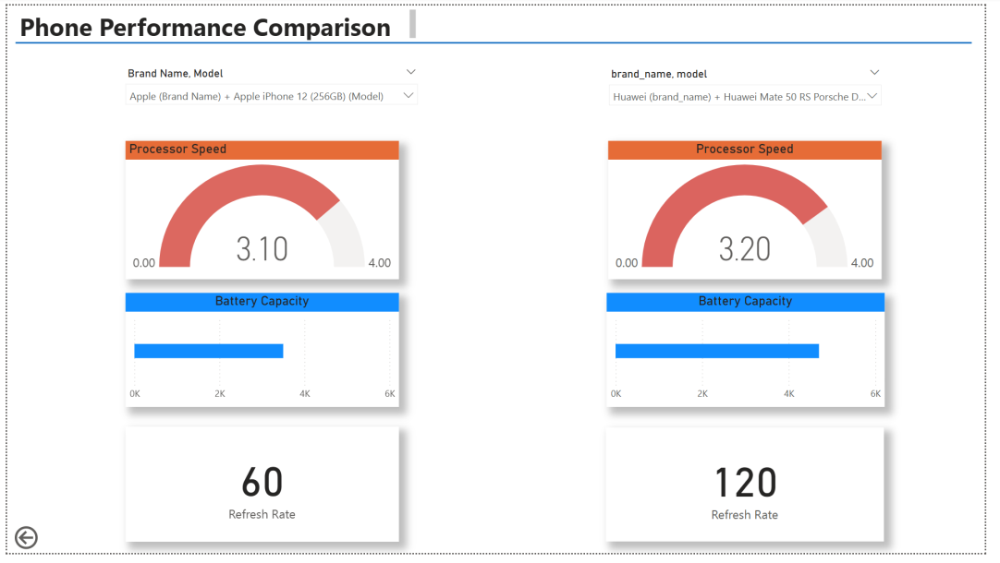
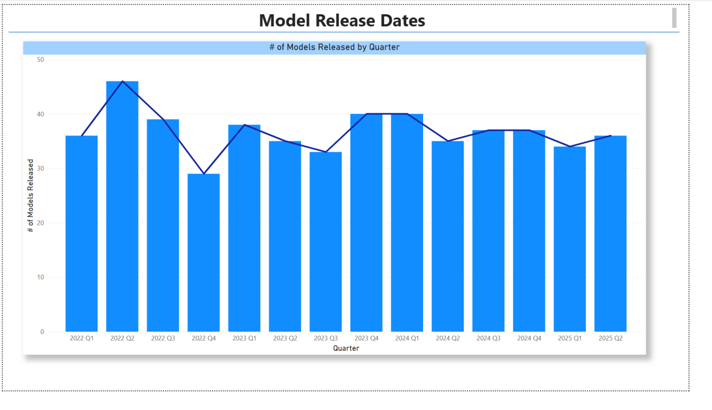

# Smartphone Market Analysis

School project. A six-page Power BI dashboard on smartphone features, pricing and ratings, with a star schema data model and DAX measures.

## Data

Kaggle smartphones dataset, 980 models and 26 columns (brand, model, price, rating, processor, RAM, battery, cameras, 5G, NFC, fast charging and more). Prices are in Indian rupees.

## Data preparation and model

- Missing values were filled using related columns, with brand-level averages or forward and backward fill for ratings and processor details.
- The flat file was reshaped into a star schema: `model_fact`, `brand_dim`, `processor_dim` and `Calendar_dim`, joined on generated keys.
- Two calculated columns were added: screen resolution and a camera capability score.

## DAX measures

Average rating, average price, average RAM, % of models with 5G, NFC and fast charging (and their complements), median RAM by price range, and models with extended memory. The percentage measures use `DIVIDE` with `CALCULATE`.

## Dashboard pages

| Preview | Page |
|---------|------|
|  | Market overview and top models |
|  | Feature comparison |
|  | Connectivity and charging |
|  | Value and price analysis |
|  | Performance comparison |
|  | Model release dates |

## Key insights

- Xiaomi (23.84%) and Samsung (23.64%) lead market share, followed by Vivo, Realme and Oppo.
- Average price is 32.56K rupees, a mid-range market. Phones above 50K have higher ratings.
- 56.1% of models support 5G.
- Intel processors have the highest average price (80K+), followed by MediaTek and Qualcomm.

## Limitation

The dataset has no release dates, so the release dates page uses generated placeholder dates (2022 to 2025). Treat that page as a design demonstration, not a finding.

## Files

- `smartphone-market-analysis.pbix`
