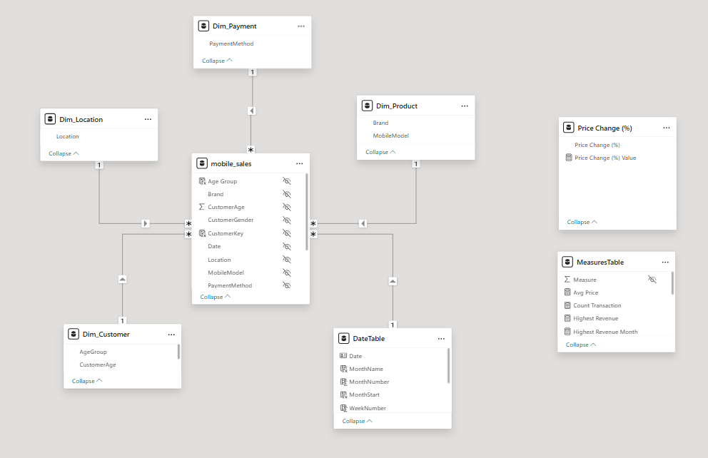
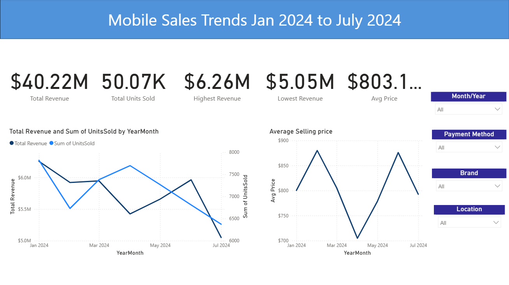
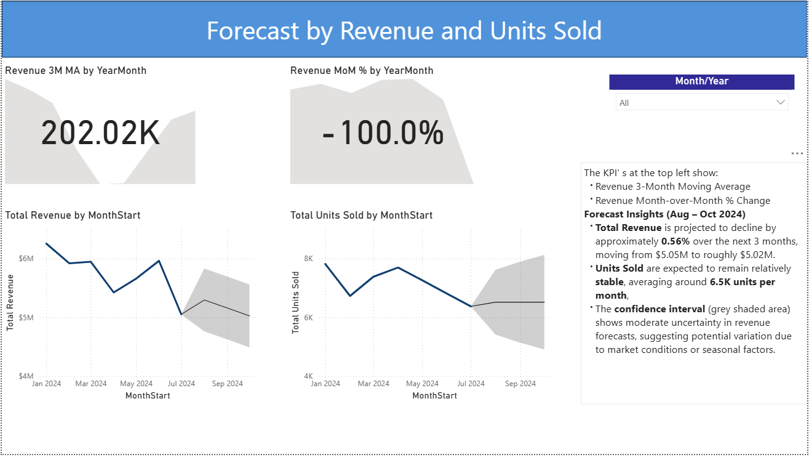
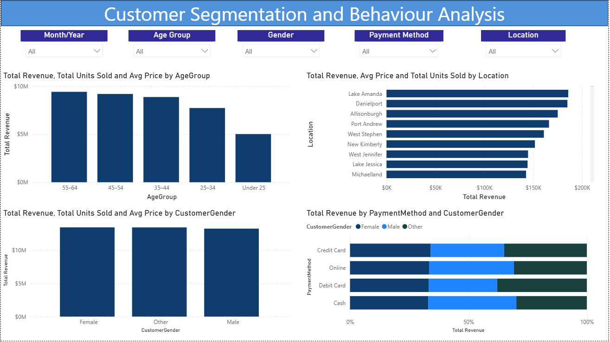
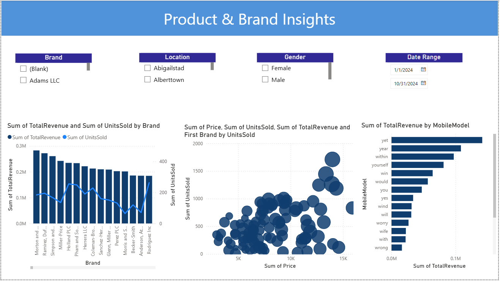
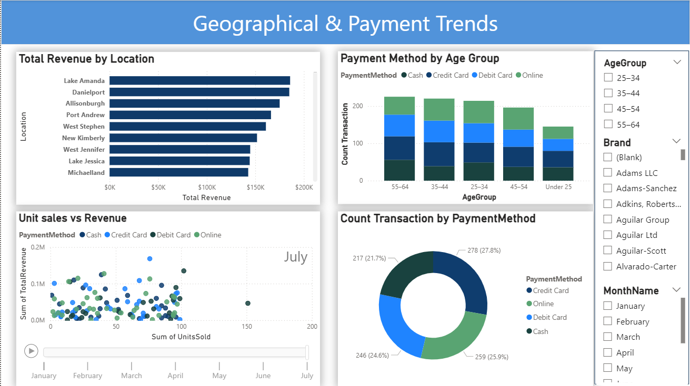
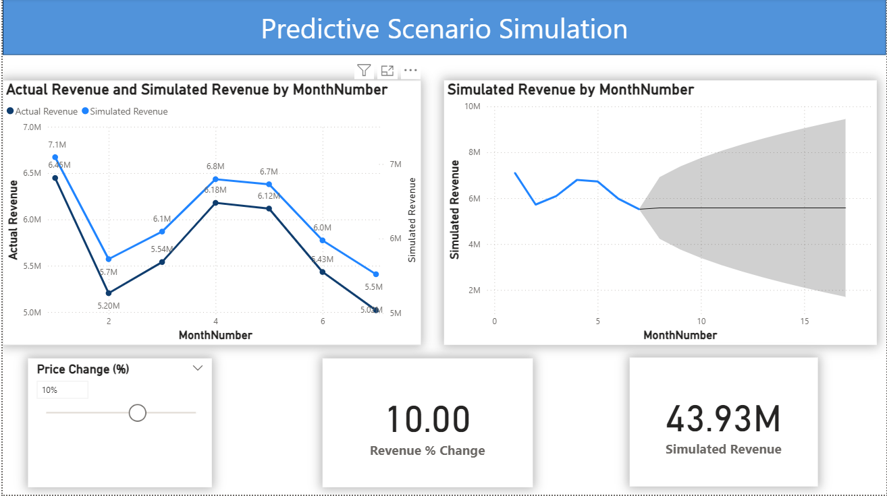

# Mobile Sales Forecasting

School project. A Power BI report that forecasts sales, segments customers and simulates price changes.

> **The data is synthetic.** Brand, model and location names are randomly generated, so the figures below show how the dashboard works. They are not real market findings.

## Data

1,000 mobile sales transactions from January to July 2024: date, brand, model, price, units sold, total revenue, customer age and gender, location and payment method.

## Data model

Star schema with a `mobile_sales` fact table and dimension tables for product, customer (age group, gender), location, payment method and a date table. Two helper tables hold a price change % parameter for what-if simulation and all DAX measures.

## Forecasting

Monthly units sold and revenue were forecast with Power BI's exponential smoothing, using a 3-month horizon and the default confidence interval. The assumption is that recent trends approximate short-term demand. With only seven months of history, the forecast is indicative.

## Dashboard pages

| Preview | Page |
|---------|------|
|  | Time-based sales trends (monthly) |
|  | Forecast by revenue and units sold |
|  | Customer segmentation and behaviour |
|  | Product and brand insights |
|  | Geographical and payment trends |
|  | Predictive scenario simulation (price change from -50% to +50%) |

## What the dashboard shows

- Sales follow a peak, decline, recovery pattern: a strong January, a mid-year decline to a July low, and a modest forecast recovery for August to October.
- Revenue is highest among customers aged 55 to 64, then 45 to 54, and lowest under 25.
- Credit card and online payments dominate across segments.
- Mid-priced products (about 5K to 10K) cluster at strong sales volumes.
- The price simulation shows revenue responds measurably to pricing changes.

## DAX examples

    Total Revenue = SUM('mobile_sales'[TotalRevenue])
    Total Customers = DISTINCTCOUNT(mobile_sales[CustomerKey])
    Revenue 3M MA = AVERAGEX(DATESINPERIOD('DateTable'[Date], MAX('DateTable'[Date]), -3, MONTH), [Total Revenue])

## Files

- `mobile-sales-forecasting.pbix`
