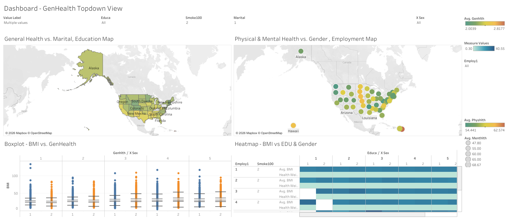

# Health Survey Dashboards (Tableau)

School project. A Tableau dashboard exploring self-reported general health across US states, using public CDC Behavioral Risk Factor Surveillance System (BRFSS) survey data.

**Live dashboard:** [Open on Tableau Public](https://public.tableau.com/app/profile/angela.abongo/viz/Health-Survey-Dashboards)

## Data

BRFSS survey responses (241,277 respondents, 22 fields) joined to a state code lookup table. Survey answers are stored as numeric codes, so the dashboard filters by code values.

## Dashboard

| Preview | Dashboard |
|---------|-----------|
|  | GenHealth top-down view |

The dashboard has four linked views and a shared set of filters:

- **General health map:** average general health score by state, filtered by marital status and education.
- **Physical and mental health map:** average physical and mental health scores by state, filtered by gender and employment.
- **Boxplot:** BMI distribution at each general health level, split by gender.
- **Heatmap:** average BMI by education level and gender, broken out by employment and smoking status.

Filters: education, smoking status (100 cigarettes), marital status, gender, employment and value label.

## Tools

Tableau Public, with calculated fields (such as BMI), maps, boxplots, heatmaps and dashboard filter actions.
