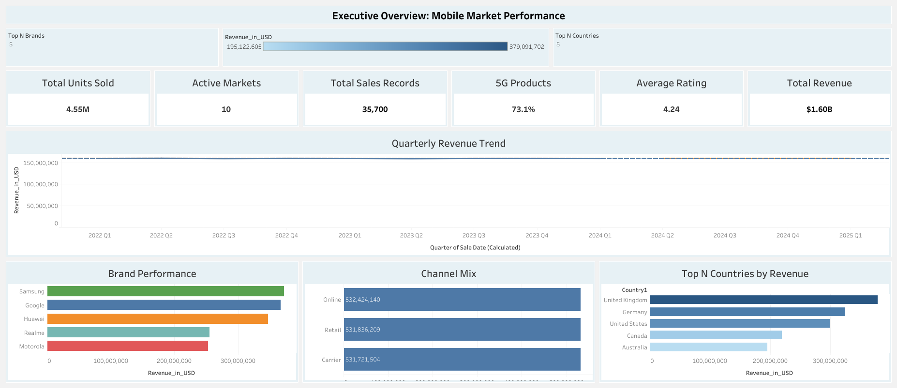
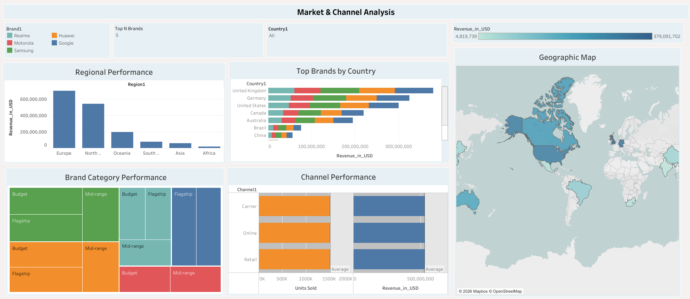
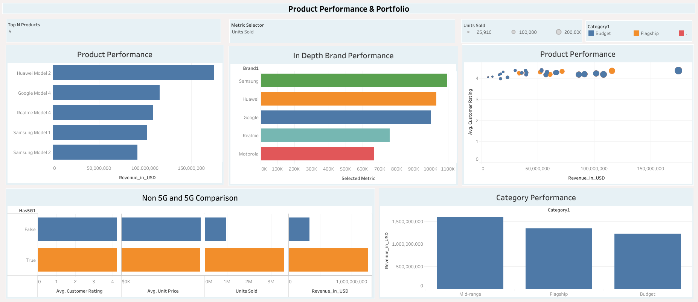
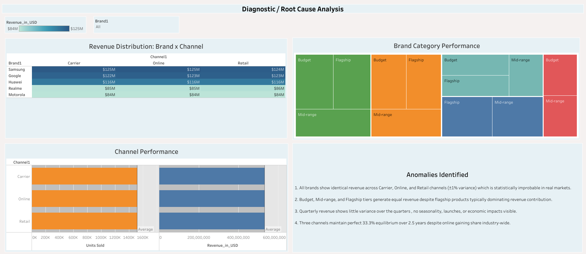

# Mobile Market Analysis (Tableau)

School project. A four-dashboard Tableau workbook on mobile phone sales across countries, brands and sales channels.

**Live dashboards:** [Open on Tableau Public](https://public.tableau.com/app/profile/angela.abongo/viz/MobileMarketAnalysis-Assignment)

## Data

Mobile phone sales records (35,700 records, 10 markets, 5 top brands shown, 3 sales channels, quarterly from 2022). The data appears to be synthetic: the diagnostic dashboard shows revenue spread almost perfectly evenly across channels, brands and tiers, which real markets do not do. Read the figures as a demonstration of the dashboards, not as real market findings.

## Dashboards

| Preview | Dashboard |
|---------|-----------|
|  | Executive overview: mobile market performance |
|  | Market and channel analysis |
|  | Product performance and portfolio |
|  | Diagnostic and root cause analysis |

### Executive overview

KPI cards (total revenue, units sold, active markets, sales records, 5G share, average rating), a quarterly revenue trend with a forecast, brand performance, channel mix and top countries by revenue. Top N filters let the viewer change how many brands and countries are shown.

### Market and channel analysis

Regional performance, top brands by country, a geographic map of revenue, brand category performance (budget, mid-range, flagship) and channel performance by units sold and revenue.

### Product performance and portfolio

Top products by revenue, an in-depth brand view with a metric selector (for example units sold), a scatter plot of customer rating against revenue, a 5G vs non-5G comparison and category performance.

### Diagnostic and root cause analysis

Revenue by brand and channel, brand category performance, channel performance and a list of anomalies identified in the data.

## Key figures (executive overview)

- Total revenue of $1.60B from 4.55M units sold across 10 active markets.
- 73.1% of products are 5G and the average customer rating is 4.24.
- Samsung leads brand revenue, followed by Google and Huawei.
- The United Kingdom has the highest revenue among countries, followed by Germany and the United States.
- Europe is the highest-revenue region, followed by North America.
- Revenue is almost equal across channels: online 532.4M, retail 531.8M and carrier 531.7M.

## Anomalies identified in the data

1. All brands show identical revenue across carrier, online and retail channels (within about 1% variance).
2. Budget, mid-range and flagship tiers generate similar revenue, although flagship products usually dominate revenue in real markets.
3. Quarterly revenue shows almost no variance, with no visible seasonality, launches or economic effects.
4. The three channels hold an almost perfect one-third share each over the whole period.

These patterns are why the data is treated as synthetic.

## Tools

Tableau Public, with calculated fields, parameters (top N, metric selector) and a forecast.
