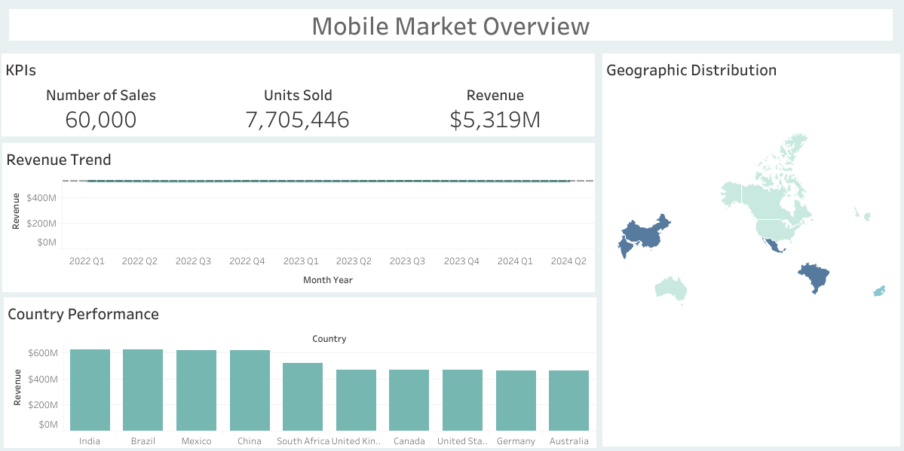
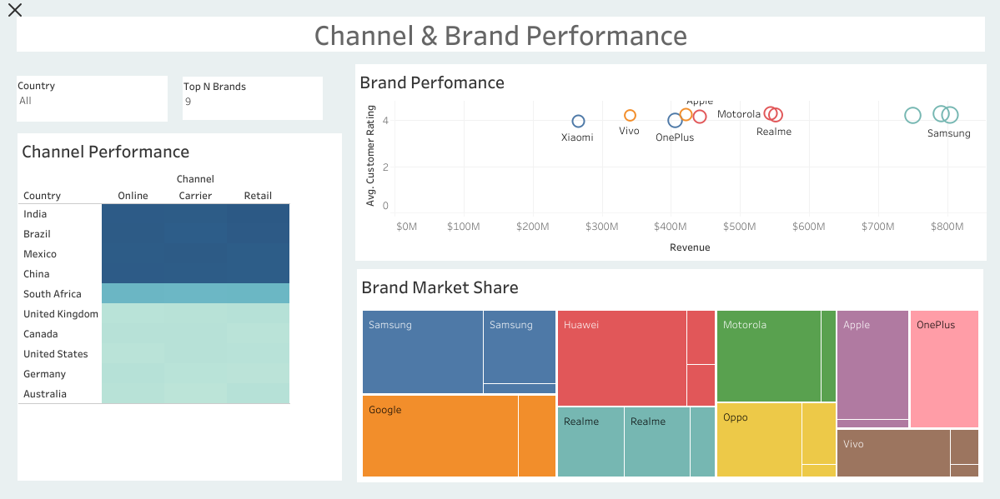
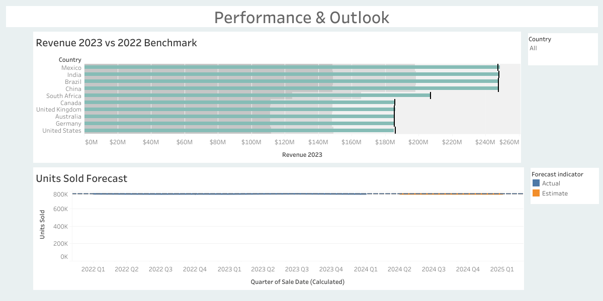

# Mobile Market Overview (Tableau)

School project. A three-dashboard Tableau workbook on mobile phone sales across 10 countries, brands and sales channels, built on a star schema.

**Live dashboards:** [Open on Tableau Public](https://public.tableau.com/app/profile/angela.abongo/viz/Mobile-Market-Overview)

## Data

A sales fact table (60,000 records) joined to country, date and product tables, covering Q1 2022 to Q2 2024. The data appears to be synthetic: monthly revenue is almost flat, the top four countries have near-identical revenue and the bottom five do too. Read the figures as a demonstration of the dashboards, not as real market findings.

## Dashboards

| Preview | Dashboard |
|---------|-----------|
|  | Mobile market overview |
|  | Channel and brand performance |
|  | Performance and outlook |

### Mobile market overview

KPI cards (60,000 sales, 7,705,446 units sold, $5,319M revenue), a quarterly revenue trend, revenue by country and a map of geographic distribution.

### Channel and brand performance

A country by channel heatmap (online, carrier, retail), brand revenue against average customer rating, and a brand market share treemap. Country and Top N brands filters.

### Performance and outlook

2023 revenue against the 2022 benchmark by country, and a units sold forecast with actual and estimated quarters. Country filter.

## Tools

Tableau Public, with calculated fields, a Top N parameter, a benchmark comparison and a forecast.
